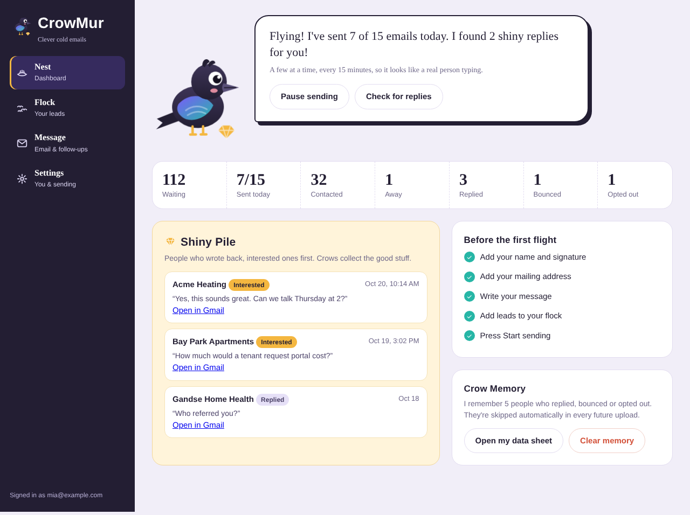

# CrowMur 🐦‍⬛

**Clever cold emails that land softly.**

CrowMur is a cold email portal built on Google Apps Script. Each user signs in with their own Google account, uploads a lead list, writes their message, and CrowMur sends it from **their own Gmail**, slowly and safely, with automatic follow-ups.

## Features

- **Away Mode.** Reads out-of-office replies, finds the return date ("back on Nov 3", "until 28 October"), and holds the follow-up until the day after the person is back.
- **Shiny Pile.** Sorts replies into Interested, Not interested and Stop, and collects interested replies on the dashboard with a one-click link to the Gmail thread.
- **Crow Memory.** Anyone who replied, bounced or opted out is remembered and skipped automatically in every future upload.
- **Caw-Check.** A live 0–100 score that flags spam triggers while you write: spammy words, too many links, ALL CAPS, missing personalization.
- **Safe sending.** Small batches every 15 minutes, business hours only, rotating subject lines, plain text, daily limits.
- **Built-in compliance.** Every email includes the sender's mailing address and an opt-out line (CAN-SPAM).
- **Private by design.** Each user's leads live in a spreadsheet in their own Google Drive.

## Files

| File | What it is |
|---|---|
| `Code.gs` | Server code: sending, reply sorting, Away Mode, Crow Memory |
| `index.html` | The app interface |

## Deploy your own copy

1. Go to [script.google.com](https://script.google.com) and click **New project**.
2. Paste `Code.gs` into the default code file.
3. Click **+ → HTML**, name it `index`, and paste `index.html`.
4. Click **Deploy → New deployment → Web app** and set:
   - **Execute as:** User accessing the web app
   - **Who has access:** Anyone with a Google account
5. Open the web app link, approve the permissions, and follow the checklist on the Nest page.

> First-time users see "Google hasn't verified this app." Click **Advanced → Go to CrowMur** to continue. Unverified apps are limited to 100 users.

## Limits

- Regular Gmail accounts can send about 100 emails a day from scripts; CrowMur caps sending at 50 a day per user.
- Users are responsible for the quality and legality of the lead lists they upload.

---

Built by **Mia Marie Briones**, [MA System Solutions](https://masystemsolutions.github.io/)
